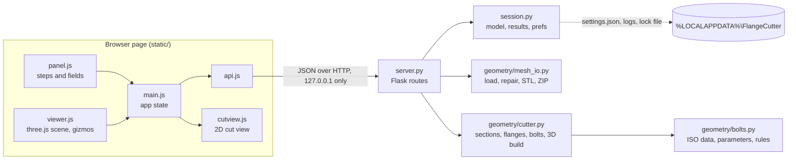

# Architecture

Flange Cutter is a local web app: a small Python server does the geometry, and one web page in
the user's own browser shows the model and the controls. Nothing leaves the computer.

## Data flow



1. **Open**: the page uploads the STL (`POST /api/model`). `mesh_io.load_stl` reads it with
   trimesh, repairs small problems, checks it is closed, and builds a Manifold twin.
2. **Edit cuts**: every change (plane, side, bolts, parameters of any cut) sends all cuts to
   `POST /api/preview` (debounced). The answer is 2D data per cut in that cut's plane frame;
   the page draws it on the planes and in the 2D cut view.
3. **Generate**: `POST /api/generate` builds the solid once, splits it into parts, checks them,
   and returns the parts list. The page loads each part's STL and places it with its matrix.
4. **Export**: the part STLs and a ZIP (all parts + `report.txt` + `settings.json`) are plain
   downloads.

State lives in memory (`session.py`): one open model and the last three results. On disk the
app writes only to its folder in the user profile: `settings.json` (last-used values),
`logs/flangecutter.log` (rotating, 3 x 1 MB) and `flangecutter.lock` (the port of the running
app). `FLANGECUTTER_HOME` overrides the folder (tests use it).

## Modules

| File | Job |
|---|---|
| `flangecutter/__main__.py` | Start: logging, single-instance check (lock file + `/api/ping`), server on 127.0.0.1 with a free port, open the browser. |
| `flangecutter/server.py` | Flask routes. Thin: validation and geometry live in `geometry/`. Maps `CutError` to HTTP 400. Refuses requests whose Host or Origin is not local. |
| `flangecutter/session.py` | In-memory model and results; app folder; preferences. |
| `flangecutter/geometry/bolts.py` | All ISO data, the fastening registry, parameter metadata (labels, units, ranges, help), derived defaults, the bolt length rule. |
| `flangecutter/geometry/mesh_io.py` | Load, repair, check; STL and ZIP output. |
| `flangecutter/geometry/cutter.py` | Plane frames, sections, flange outlines, bolt placement, all checks, 3D build, parts, reports. |
| `flangecutter/static/` | The page: `index.html`, `app.css`, `js/main.js` (wiring and state), `js/viewer.js` (3D), `js/panel.js` (steps and fields), `js/cutview.js` (2D SVG), `js/api.js` (fetch helpers), `vendor/three/` (three.js r187, unmodified). |

## Coordinate conventions

- Units are millimeters everywhere.
- World coordinates are the STL's coordinates. The viewer is Z-up (`camera.up = (0, 0, 1)`), like
  the slicer.
- A cut plane is a three.js object: **origin** = its position, **normal** = its local +Z axis,
  **in-plane x axis** = its local +X axis. The page sends all three; the server builds an
  orthonormal frame from them (`cutter.plane_frame`), so the 2D view matches what the user sees.
- **Plane coordinates** of a cut: the plane is z = 0, the normal is +z, x and y are the in-plane
  axes. Every 2D result (section, flange, bolts) is in these coordinates, with the frame returned
  alongside.
- Side **A** of a cut is where its normal points (shown as an arrow; the page calls it the
  "arrow side"); side **B** is the other side.
- Parts are named A, B, C… in order of their **side signature** (the side of every cut, e.g.
  `"AB"`). With one cut, part A is on side A and part B on side B.
- Print position: a part lies with one of its cut faces on the print sheet (z = 0). For side A
  that is the cut's plane coordinates; for side B the same turned 180° about the plane x axis.
  `to_world` (row-major 4 × 4) maps the print position back to the world for display.

## API

All bodies are JSON; errors are `{"error": "<plain-language message>", "detail": "<technical>"}`
with HTTP 400 (the user can fix it) or 500 (a bug; details in the log).

| Route | Purpose |
|---|---|
| `GET /` | The page. |
| `GET /api/ping` | `{"app": "flangecutter", "version"}`: the single-instance check. |
| `GET /api/bolts` | Bolt sizes with ISO data and automatic values, fastening types, parameter metadata, count and spacing ranges, defaults, version. |
| `POST /api/model` | Multipart `file`. Returns `model_id`, `name`, `sha256`, `triangles`, `bbox` (`min`, `max`, `size`, `center`), `watertight`, `repaired`, `warnings`. |
| `GET /api/model/<id>/mesh.stl` | The checked mesh, for display. |
| `POST /api/preview` | 2D layout of every cut (below). Always HTTP 200; a cut with a problem carries `error`. |
| `POST /api/generate` | 3D build. Returns `result_id`, `parts`, `cuts`, `hardware`, `warnings`, `preview`, `zip`, `seconds`. HTTP 400 if any cut has an error. |
| `GET /api/progress` | `{"busy", "stage", "fraction"}` while a job runs. |
| `GET /api/result/<id>/<part>.stl` | One part in print position, e.g. `A.stl`. |
| `GET /api/result/<id>/bundle.zip` | All parts + `report.txt` + `settings.json`. |
| `GET` / `POST /api/prefs` | Last-used settings (kept across upgrades). |
| `POST /api/shutdown` | Stop the server (the Quit button). |

**Request** for preview and generate:

```json
{"model_id": "abc123",
 "cuts": [{"plane": {"origin": [0, 0, 120], "normal": [0, 1, 0], "x_axis": [1, 0, 0]},
           "side": "outside", "bolt": "M4", "fastening": "through_nut", "nut_pocket_half": "B",
           "distribution": {"mode": "count", "count": 8, "spacing": 50},
           "params": {"thickness": null, "width": null, "hole_diameter": null, "wall_gap": 1.0,
                      "edge": 2.0, "hole_clearance": 0.2, "overlap": 0.6, "max_wall_angle": 25,
                      "tool_clearance": 12, "end_margin": 3}}]}
```

`null` means automatic. The spec's single-cut form (the cut's fields at the top level, with
`count`) is still accepted. The **settings file** (Save settings, and `settings.json` in the ZIP)
is `{"format": 1, "app", "version", "model": {"name", "sha256"}, "cuts": [...]}` with the same
cut objects, so loading it is just sending its cuts.

**Preview response**, per cut: `frame` (origin, x_axis, y_axis, normal), `error` (or null),
`section` and `flange` (polygons as `{"exterior": [[x, y], …], "holes": [[[x, y], …], …]}`),
`bolts` (`xy`, `xyz`, `blocked`), `bolt_line` and `free` (polylines: the whole bolt line and the
stretches where bolts may go), `crossings` (lines where other cuts cross this plane), `cavities`
(label points), `derived` (thickness, width, bolt_line, hole_diameter, washer, bolt_length, grip,
pocket size, how far the bolt line moved), `count`, `suggested_count`, `warnings`. Top level:
`warnings` that involve two cuts, `ms`.

**Generate response**: `parts[]` (`name`, `file`, `url`, `signature`, `volume_cm3`, `size`,
`triangles`, `face_down`, `cuts`, `bolts`, `overhang_cm2`, `to_world`, `explode`), `cuts[]` (bolt
spec, nuts, washers, flange values and `joins`: which parts the cut bolts together, with how many
bolts), `hardware` (shopping list for all cuts), `warnings` (each `{code, message, action}`), and
`preview` (the final 2D layout).

## Geometry, step by step

Per cut, in that cut's plane coordinates (`cutter.section` and `cutter.layout`):

1. **Load and repair** (`mesh_io`): trimesh with `process=True`; drop degenerate and duplicate
   faces; fix winding (networkx) and inside-out bodies; refuse if not watertight ("This model has
   holes…"); build the Manifold, which must report `NoError`.
2. **Section**: `Manifold.slice(0)` gives the wall section; `trimesh.intersections.mesh_plane`
   gives the same outline as segments, each with the mesh face behind it (its normal and how far
   the wall leans).
3. **Cavity side**: per connected region of the section, the reference point is the centroid of
   that region's convex hull. A segment faces away from the cavity when its normal points away
   from that point. "Outside" uses those segments, "Inside" the others.
4. **Flange outline (2D)**: segments merged into chains (`linemerge`, coordinates rounded to
   1e-5 mm); per chain a band of width W on the flange side plus a 0.6 mm overlap strip into the
   wall; minus a guard band (W + 2 mm) on the cavity side of the opposite chains. Each flange half
   also loses the guard band found at its own outer face (z = ±T). Snapped to a 0.01 mm grid.
5. **Bolt line**: the chains offset by c toward the flange side, sampled every 0.5 mm; only the
   stretches where a bolt clears every other cut stay (see below).
6. **Bolts**: by arc length; evenly around closed rings; on open stretches with the end margin
   (c + washer/2 + end distance) at real flange ends. Count mode shares the count by length
   (largest remainder, at least 2 per stretch where they fit); spacing mode aims for the given
   distance. Too many bolts for the room is an error that names the maximum.
7. **Tool clearance**: the mold beyond both flange faces (up to the tool clearance) is projected
   onto the plane once; a bolt is blocked if its tool disc (washer/2 + 0.5 mm) overlaps that
   shadow. While any bolt is blocked the bolt line moves out 1 mm (up to 6 mm).
8. **Checks and warnings**: wall angle (95th percentile of the flange-side lean), bolt spacing,
   washer fit, blocked bolts, count raised, stretches without room for a bolt.

**Crossing cuts.** A bolt position p of cut i is kept only if, for every other cut j,
`max(0, |dist(p, plane j)| − (T_i + H_i)·|cos θ|) − r_i·sin θ ≥ T_j + protrusion_j + 0.5 mm`,
where θ is the angle between the planes, H the tool clearance, r = washer/2 + 0.5 mm and
protrusion = how far bolt end, nut or head stick out of a flange face. So holes, washers, nuts and
tools of one cut never meet the other cut's flange or hardware. Two cuts must cross inside the
wall at 15° or more, or keep their flanges apart; this is judged from where each plane lies
relative to the other cut's wall section.

Then, once for all cuts (`cutter.generate`):

9. **Solid**: mold ∪ every flange slab (outline extruded from −T to +T) − every bolt hole and nut
   pocket. Only **then** split by every plane in turn.
10. **Parts**: each cell is split into its bodies; loose pieces of flange without mold are left
    out; every body is a part.
11. **Joins and orientation**: slices just beside every cut give each part's cut faces, which
    parts touch and which bolts hold them. Each part lies on the cut face that leaves the least
    overhang (ties: the larger face).
12. **Checks**: parts or joints with no bolt or one bolt, small or mostly-flange parts, flanges
    that print in mid-air, and an export-and-reload watertight check of every part.

### Pitfalls (found the hard way; keep them)

- **Split last.** Adding a flange to an already split half makes coplanar faces; after float32
  STL export such parts are no longer watertight.
- **Never move the 3D split off the plane.** Vertices exactly on the plane are handled by
  Manifold. Only the trimesh outline is shifted by 1 µm (duplicate edges otherwise). Shifting the
  split leaves 1 µm slivers that break after export.
- **Snap flange outlines** to 0.01 mm. Outline points made from chain ends lie exactly on the
  mold surface; Manifold then leaves sub-micron edges that collapse in float32.
- **Single-sided buffers** misbehave on closed rings: closed chains use polygon offsets
  (`_side_band`).
- **Leaning walls**: a straight flange slab next to a leaning wall pokes into the cavity unless
  each half is also guarded at its outer face; open guard chains must be prolonged past rims.
- **Two slabs must not share faces.** Different outlines for the two halves are built as one slab
  plus trimming prisms that start 0.02 mm off the plane.
- **trimesh 5** `fix_normals()` silently needs scipy; call the repair steps one by one.
- **trimesh caches** re-hash the whole mesh on every access to `face_normals` and `bounds`; the
  model keeps plain copies.
- **Manifold is lazy**: an operation's cost shows up where its result is first used.
- **Manifold.to_mesh() is float32**: take heights from `bounding_box()` (double).
- **Windows MIME types**: some registries serve `.js` as `text/plain`, which breaks ES modules;
  `server.py` registers the right type.

## Performance

Measured on the development laptop (server side, Python 3.12, lengthwise cut of the demo mold
shape at different resolutions; median of 3 runs where marked):

| Model | Open and check | Preview (cut moved / only bolts changed) | Generate |
|---|---|---|---|
| Demo mold, 32,000 triangles, one cut (median) | 0.12 s | 0.06 s / 0.02 s | 0.23 s |
| 103,000 triangles, one cut (median; spec target 0.3 s / 3 s) | 0.48 s | 0.13 s / 0.04 s | 0.59 s |
| 1,008,000 triangles, one cut | 5.0 s | 0.57 s / 0.10 s | 5.6 s |
| 1,008,000 triangles, two crossing cuts | | 1.26 s / 0.32 s | 7.3 s |

The tilted transverse cut of the speed test (`tests/test_geometry.py`, 103,000 triangles), where the
bolt line moves out twice, takes about 0.2 s to preview and 0.75 s to generate.

Each cut's section is cached on the model, so moving one cut recomputes only that cut's section;
the other cuts are laid out again from their cached sections. The page shows a progress bar during
Generate (`/api/progress`).

## Extending

- **Bolt size**: one `Bolt(...)` line in `geometry/bolts.py` (hole, washer, nut data). The page
  reads sizes from `/api/bolts`.
- **Fastening type**: add a `Fastening` to `FASTENINGS` (label, help, washers per bolt), give it
  a grip rule in `bolts.bolt_length()`, and, if it changes the solid, its cutters in
  `cutter._fastening_cutters()`. The page reads the list from `/api/bolts`.
- **Parameter**: add a `Param` to `PARAMS` (label, unit, range, default, help); the page builds
  the field from the metadata; use the value in `bolts.derive()`.
