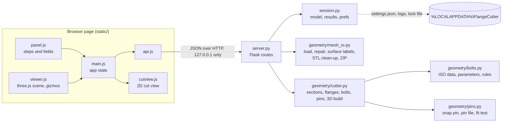

# Architecture

Flange Cutter is a local web app: a small Python server does the geometry, and one web page in
the user's own browser shows the model and the controls. Nothing leaves the computer.

## Data flow



1. **Open**: the page uploads the STL (`POST /api/model`). `mesh_io.load_stl` reads it with
   trimesh, repairs small problems, checks it is closed, builds a Manifold twin, and labels every
   face: outer side, inner side or rim of a thin shell, or OTHER (step 1 below).
2. **Edit cuts**: every change (plane, side, bolts, parameters of any cut) sends all cuts to
   `POST /api/preview` (debounced). The answer is 2D data per cut in that cut's plane frame;
   the page draws it on the planes and in the 2D cut view.
3. **Generate**: `POST /api/generate` builds the solid once, splits it into parts, checks them,
   and returns the parts list. The page loads each part's STL and places it with its matrix.
4. **Export**: the part STLs (cleaned of sliver triangles, step 13 below), with pins also each pin
   cut's pin file and the fit tests (step 14), and a ZIP (all of them + `report.txt` +
   `settings.json`) are plain downloads.

State lives in memory (`session.py`): one open model and the last three results. On disk the
app writes only to its folder in the user profile: `settings.json` (last-used values),
`logs/flangecutter.log` (rotating at 1 MB, with the 3 older files kept: 4 MB at most) and
`flangecutter.lock` (the port of the running
app). `FLANGECUTTER_HOME` overrides the folder (tests use it).

## Modules

| File | Job |
|---|---|
| `flangecutter/__main__.py` | Start: logging, single-instance check (lock file + `/api/ping`), server on 127.0.0.1 with a free port, open the browser. If another version is running, it offers in its console window to close that one (`/api/shutdown`) and then starts; without a console it opens the running one. |
| `flangecutter/server.py` | Flask routes. Thin: validation and geometry live in `geometry/`. Maps `CutError` to HTTP 400. Refuses requests whose Host or Origin is not local. |
| `flangecutter/session.py` | In-memory model and results; app folder; preferences. |
| `flangecutter/geometry/bolts.py` | All ISO data, the fastening registry, parameter metadata (labels, units, ranges, help), derived defaults, the bolt length rule. |
| `flangecutter/geometry/mesh_io.py` | Load, repair, check; label every face at load (outer side, inner side, rim or OTHER: `shell_surfaces`); STL output with sliver clean-up (`stl_bytes`); ZIP output. |
| `flangecutter/geometry/cutter.py` | Plane frames, sections, flange outlines, bolt and pin placement, all checks, 3D build, parts, pin files, reports. |
| `flangecutter/geometry/pins.py` | The printed snap pin (decisions 57-62): sizes from the diameter and the grip (`PinSpec`), the slot rule and the beam mechanics (cached), the pin solid, the pin file (pins lying flat), the hole cutter with its bevels, the fit test. |
| `flangecutter/static/` | The page: `index.html`, `app.css`, `js/main.js` (wiring and state), `js/viewer.js` (3D), `js/panel.js` (steps and fields), `js/cutview.js` (2D SVG), `js/api.js` (fetch helpers), `vendor/three/` (three.js r187, unmodified). |

## Coordinate conventions

- Units are millimeters everywhere.
- World coordinates are the STL's coordinates. The viewer is Z-up (`camera.up = (0, 0, 1)`), like
  the slicer.
- A cut plane is a three.js object: **origin** = its position, **normal** = its local +Z axis,
  **in-plane x axis** = its local +X axis. The page sends all three; the server builds an
  orthonormal frame from them (`cutter.plane_frame`), so the 2D view matches what the user sees.
- **Plane coordinates** of a cut: the plane is z = 0, the normal is +z, x and y are the in-plane
  axes. Every 2D result (section, flange, bolts) is in these coordinates, with the frame returned
  alongside.
- Side **A** of a cut is where its normal points (shown as an arrow; the page calls it the
  "arrow side"); side **B** is the other side.
- Parts are named A, B, C… in order of their **side signature** (the side of every cut, e.g.
  `"AB"`), the largest body first where one signature has several bodies. With one cut, part A is
  on side A; part B is on side B unless side A has several bodies.
- Print position: a part lies with one of its cut faces on the print sheet (z = 0). For side A
  that is the cut's plane coordinates; for side B the same turned 180° about the plane x axis.
  `to_world` (row-major 4 × 4) maps the print position back to the world for display.

## API

Requests and answers are JSON, except the STL upload (multipart) and the STL and ZIP downloads.
Errors are `{"error": "<plain-language message>", "detail": "<technical>"}` with HTTP 400 (the user
can fix it), 403 (a request from outside this computer), 413 (a file over 512 MB) or 500 (a bug;
details in the log).

| Route | Purpose |
|---|---|
| `GET /` | The page. |
| `GET /api/ping` | `{"app": "flangecutter", "version"}`: the single-instance check. |
| `GET /api/bolts` | Bolt sizes with ISO data and automatic values, the pin (`pin`: key, label, help, spares, suggest_pitch, automatic values), fastening types, parameter metadata (with `kinds`: the fasteners that use it, and the pin wording `pin_label`, `pin_help`), count and spacing ranges, defaults, version. |
| `POST /api/model` | Multipart `file`. Returns `model_id`, `name`, `sha256`, `triangles`, `bbox` (`min`, `max`, `size`, `center`), `watertight`, `repaired`, `warnings`. |
| `GET /api/model/<id>/mesh.stl` | The checked mesh, for display. |
| `POST /api/preview` | 2D layout of every cut (below). HTTP 200 also when a cut has a problem: that cut carries `error`. An invalid request (a model that is no longer open, no cuts, unknown or out-of-range settings) gets HTTP 400. |
| `POST /api/generate` | 3D build. Returns `result_id`, `parts`, `cuts`, `hardware`, `pins`, `fit_tests`, `warnings`, `preview`, `zip`, `seconds`. HTTP 400 if any cut has an error. |
| `GET /api/progress` | `{"busy", "stage", "fraction"}` while a job runs. |
| `GET /api/result/<id>/<part>.stl` | One part in print position, e.g. `A.stl`. |
| `GET /api/result/<id>/pins/<n>.stl` | The pin file of cut n (1-based). Its own path segment: a flat `pins_1.stl` would fall into the part route. |
| `GET /api/result/<id>/fit/<n>.stl` | The fit test whose first cut is n. |
| `GET /api/result/<id>/bundle.zip` | All parts, pin files and fit tests + `report.txt` + `settings.json`. |
| `GET` / `POST /api/prefs` | Last-used settings (kept across upgrades). |
| `POST /api/shutdown` | Stop the server (the Quit button). |

**Request** for preview and generate:

```json
{"model_id": "abc123",
 "cuts": [{"plane": {"origin": [0, 0, 120], "normal": [0, 1, 0], "x_axis": [1, 0, 0]},
           "side": "outside", "bolt": "M4", "fastening": "through_nut", "nut_pocket_half": "B",
           "distribution": {"mode": "count", "count": 8, "spacing": 50},
           "params": {"thickness": null, "width": null, "hole_diameter": null, "wall_gap": 1.0,
                      "edge": 2.0, "hole_clearance": 0.2, "max_wall_angle": 25,
                      "tool_clearance": 12, "end_margin": 3}}]}
```

A cut with pins has `"bolt": "pin"` and the pin numbers among its params (`pin_diameter`,
`pin_hole_clearance`, `pin_preload`); its `nut_pocket_half` is the side the pins go in from, its
`fastening` is kept but ignored. Every cut carries every parameter (decision 59).

`null` means automatic. The spec's single-cut form (the cut's fields at the top level, with
`count`) is still accepted; unknown parameters such as the spec's `overlap` are ignored. The **settings file** (Save settings, and `settings.json` in the ZIP)
is `{"format": 1, "app", "version", "model": {"name", "sha256"}, "cuts": [...]}` with the same
cut objects, so loading it is just sending its cuts.

**Preview response**, per cut: `frame` (origin, x_axis, y_axis, normal), `error` (or null),
`section` and `flange` (polygons as `{"exterior": [[x, y], …], "holes": [[[x, y], …], …]}`),
`bolts` (`xy`, `xyz`, `blocked`), `bolt_line` and `free` (polylines: the whole bolt line and the
stretches where bolts may go), `crossings` (lines where other cuts cross this plane), `cavities`
(label points), `derived` (thickness, width, bolt_line, hole_diameter, washer, bolt_length, grip,
pocket size, how far the bolt line moved; `kind` "bolt" or "pin", and `pin`: diameter, head,
head_height, barb, length; `washer` is the pin head for pins), `count`, `suggested_count`, `warnings`.
A cut with an error has only `frame`, `error` and its own `derived` (decision 72). Top level:
`warnings` that involve two cuts, `ms`.

**Generate response**: `parts[]` (`name`, `file`, `url`, `signature`, `volume_cm3`, `size`,
`triangles`, `face_down`, `cuts`, `bolts`, `pins`, `overhang_cm2`, `to_world`, `explode`), `cuts[]`
(bolt spec, nuts, washers, flange values, `joins`: which parts the cut bolts together, with how many
bolts, `kind`, and for pin cuts `pin`: diameter, length, grip, head_side, push_from, needed, spares,
count; the keys named `bolts` count the pins of a pin cut), `hardware` (shopping list for all cuts;
pin cuts buy nothing), `pins[]` (per pin cut: `cut`, `count`, `needed`, `spares`, `diameter`,
`length`, `flange_thickness`, `grip`, `hole_diameter`, `head_side`, `push_from`, `same_as`, `size`,
`triangles`, `file`, `url`), `fit_tests[]` (`cuts`, `diameter`, `flange_thickness`, `hole_diameter`,
`size`, `triangles`, `file`, `url`), `warnings` (each `{code, message, action}`), and `preview` (the
final 2D layout).

## Geometry, step by step

Per cut, in that cut's plane coordinates (`cutter.section` and `cutter.layout`):

1. **Load and repair** (`mesh_io.load_stl`): trimesh with `process=True`; drop degenerate and
   duplicate faces; fix winding (networkx); refuse if not watertight ("This model has holes…");
   turn the whole model the right way out when its volume is negative (one inside-out body among
   several stays as it is); build the Manifold, which must report `NoError`. Then **label every face**
   (`mesh_io.shell_surfaces`). A thin-walled mold is a thickened surface: an outer and an inner
   side, joined along the mold's edge by a narrow **rim** that meets them at sharp edges.
   - Faces are grouped into patches across smooth edges (under 45°). A patch is **thin** when its
     area divided by the length of its border is under the wall thickness estimate (the model's
     volume / half its area): a strip up to about twice the wall wide.
   - Thick patches joined across sharp edges make a **surface**. Thin patches joined across sharp
     edges make a **thin region**.
   - A surface faces **outward** when, weighted by area, its normals point away from the center of
     its body; otherwise it faces **inward**. The outward surfaces are the outer side of the wall,
     with any raised pad or label on it. The inward ones are the inner side (several where two
     cups are joined).
   - A thin region that touches surfaces of one side only (all outward or all inward) belongs to
     the largest of them (the walls of a pad, the walls and floor of an engraved line). One that
     touches both sides is **rim**, also when it is made of several facets.
   - A body with outward and inward surfaces joined by rim is a **thin shell**, if its two sides
     differ in area by at most 2 times (the two faces of a thin wall have about the same area).
     Every other body is labeled **OTHER**, and the cutter uses the POC's per-segment rule there
     (step 3).
   - **Second look** (`mesh_io.wall_end`, decision 54). Where the mold's edge is rounded (the normal
     turns over in steps under 45°) or ends in a knife edge (the two faces meet at one sharp edge,
     with no rim between them), the outer and inner side come out as one surface, and the body as
     OTHER. So the faces are also grouped a second time, with the **wall's end** as extra patch
     borders. The wall direction at a face is the main axis of the face normals (weighted by area)
     in the 2 × 2 × 2 cells of two wall thicknesses nearest to the face: both faces of the wall
     point along it, one each way. Long triangles are first cut into pieces of at most one cell,
     so that every cell sees the surface that is in it. A face more than 60° off the wall direction
     is the wall's end (the rim, or the middle of a rounded edge). So are both faces of an edge
     where the normal crosses from one side of the wall to the other while both stay within 60° of
     the wall direction (a knife edge), read against the first face's wall direction, and against
     the second face's own where the two directions are clearly one axis (at a square bend of the
     wall they are square to each other, and their sign is rounding noise). An edge between a face
     of the wall's end and one that is not parts patches; everything else is as above.
   - **Which look** (`mesh_io._choose`, decision 56), per body (connected part of the mesh): the
     first look, unless it labeled the body OTHER, or both looks found a shell but put more than
     0.1 % of the body's area on opposite sides, outward in one and inward in the other (a rounded
     stretch joined part of one face to the other, and a pad or an engraved line made the rest still
     look like a shell). On every mold that the first look labels right (the four real molds of
     1.0.1, the test molds with a square edge, plain CAD cups), the two looks put no face on
     opposite sides at all; faces that only change between a surface and the rim do not count,
     because the second look is less sure at sharp bends of the wall. A body that the first look
     labeled keeps exactly its labels when the second agrees. `Model.edge` (written to the log) says how
     the edge was found: `sharp`, `found from the wall direction`, `not found` or `none` (no thin
     shell, for example a solid block).
   - `Model.surfaces` holds every face's label (a surface id, `RIM` or `OTHER`); `Model.outside`
     holds the ids of the outward surfaces.
   - A thin-walled body (wall thickness under 0.1 × its smallest extent) that comes out OTHER in
     both looks gives the warning `edge_not_found`: "Flange Cutter could not find the edge of this
     mold, so it cannot tell the two faces apart. It chooses the flange side piece by piece along
     each cut." Action: "Check the flange in the preview, especially near the edge of the mold."
2. **Section**: `Manifold.slice(0)` gives the wall section; `trimesh.intersections.mesh_plane`
   gives the same outline as segments, each with the mesh face behind it (its normal, how far the
   wall leans, and its label). Both are also taken at z = ±T/2 and ±T (T is the flange thickness
   of each part), where the flange layers end (step 4): a leaning wall moves the protected face
   there, and the mold's edge may lie elsewhere, or the wall may not reach that far.
3. **Flange side**: "Outside" gives the flange to every segment of the outward surfaces, "Inside"
   to every segment of the inward surfaces, along the whole cut. The other side of the wall is the
   **protected face**. Rim segments get no flange (they are guarded like the protected face),
   except a sliver of rim shorter than the wall thickness between faces of the flange side on a
   thin shell (step 4).
   For OTHER faces the POC's rule applies (decision 13): per connected region of the section the
   reference point is the centroid of its convex hull, and a segment faces away from the cavity
   when its normal points away from that point ("Outside" uses those segments, "Inside" the
   others). The segments are merged into **flange chains** and **guard chains** (protected face
   and rim) with `linemerge` (coordinates rounded to 1e-5 mm). Each chain gets a sign (which side
   its face normals point to) and each piece of a flange chain its lean, both read from the mesh
   face behind it. At the other heights `Section.levels` keeps the wall section, the guard chains
   with their signs, and the flange chains.
4. **Flange outline (2D)** (`cutter._flange_outline`), with W the flange width:
   - **Bands**: per flange chain, a band of width W on the flange side and a fixed 0.6 mm strip
     into the wall (`OVERLAP`; the "Overlap into wall" setting is gone, and old settings files
     that contain it still load).
   - **Wedge fill**: where the wall leans away from the flange by more than 8° (`FILL_NZ`) on one
     half (z 0..T or −T..0), that half also gets a band of width W into the wall. Not within W of
     an open chain's end.
   - **Guard bands** at z = 0, ±T/2 and ±T: W + 2 mm beyond the protected face and the rim,
     clipped by the wall section at that height. Only the pieces that touch the protected face or
     the rim are kept: where the wall bends sharply, the band also reaches across the wall and
     would cut away good flange. Grown by 0.1 mm, so the flange stops 0.1 mm short of the
     protected face.
   - **Layers**: each half is two layers, 0..T/2 and T/2..T (side B: −T/2..0 and −T..−T/2). Each
     layer loses the guard bands at both of its faces. On a half with wedge fill the protected face
     moves away from the flange as the height grows, so the outer layer reaches further into the
     wall than the inner one.
   - **Label noise along the outline** (`_fill_gaps`, thin shells only): a guard run shorter than the
     wall thickness with flange on both sides (a sliver of rim between faces of the flange side,
     where the edge is rounded or knife-edged) goes to the flange side. A real crossing of the edge
     has flange on one side and the protected face on the other. On OTHER faces the guard side comes
     from the proof of concept's rule, and a groove there is a real protected face.
   - **End cuts** (`_end_cuts`, `_uncovered`), per flange chain and per layer face (z = 0, ±T/2,
     ±T). (1) Along stretches of the chain with no wall within W + 2 mm at that height, the chain's
     bands are cut away: the mold's edge is lower there, so a layer at that height would stand past
     it. (2) At every end of a flange chain at that height that meets a guard chain (the rim; on
     OTHER models the face where the flange side flips; where crumbs under 1 mm lie between them,
     the guard chain ending within 1.5 mm), the guard chain is carried on past the end by 3W + 2 mm
     (decision 55). Where the rim there is a full crossing (at least ¾ of the wall thickness and
     1 mm, not folding back: a square or slanted rim, also cut at a slant), and on OTHER guard
     chains, along the line from 1 mm back along the guard chain, as in 1.0.1.
     Elsewhere on a thin shell (a rounded or knife edge, a ridge where the edge's shape changes, a
     layer's height clipping a rim's corner) square across the wedge between the flange face
     arriving at the end and the protected face after the rim. The guard band along the carried-on
     guard chain, 3W + 2 mm wide, is cut away from the bands of the chain at the cut nearest to that
     end. That far, because where the face meets the edge at a shallow angle the flange band
     crosses the edge line far from the end. Each cut trims its own chain's bands only.
     So the flange ends flush with the mold's edge at every height where a layer ends, also where
     the edge meets the cut or the face at a slant. Where the edge is closer to the cut than the
     flange half's thickness, the layers that reach past it get no flange there. The flange is then
     shorter or thinner, and the checks of steps 8 and 12 warn when washers no longer fit or a part
     is not bolted.
   - **Result**: the cut-face outline (the preview's `flange`) is the union of the two inner
     layers. When no chain gets a wedge fill and the other heights take nothing more, one outline
     serves the whole slab (`Layout.uniform`). Every outline is snapped to a 0.01 mm grid.
5. **Bolt line**: the chains offset by c toward the flange side, sampled every 0.5 mm; only the
   stretches where a bolt clears every other cut stay (see below).
6. **Bolts**: by arc length; evenly around closed rings; on open stretches with the end margin
   (c + washer/2 + end distance) at real flange ends. Count mode shares the count by length
   (largest remainder, at least 2 per stretch where they fit); spacing mode aims for the given
   distance. Too many bolts for the room is an error that names the maximum.
7. **Tool clearance**: the mold beyond each flange face, over that face's tool height, is projected
   onto the plane once per face and height and kept on the section (`Section.shadows`,
   `_add_shadows`); a bolt is blocked if its tool disc (washer/2 + 0.5 mm) overlaps the union of the
   two faces' shadows. Bolts: the tool clearance on both faces. Pins (`_tool_heights`, decision 69):
   the head side over max(tool clearance, pin length + 8 mm), because a pin goes in only along its
   axis from there; the barb side over the tool clearance (pliers). While any bolt or pin is blocked
   the bolt line moves out 1 mm (up to 6 mm); of equal steps the first stays (decision 16); when
   every step is blocked a pin cut keeps the least mold in its discs (decision 71). The shadows
   are even-odd regions (`_cs_to_shapely`, decision 70).
8. **Checks and warnings**: wall angle (95th percentile of the flange-side lean), bolt spacing,
   washer fit (on both outer faces of the flange, z = ±T) or, for pins, `pin_fit` (the head disc
   on the full four-layer stack, `Layout.stack`), blocked bolts or, for pins, `pin_no_room` (no
   room on the head side) and `bolts_blocked` (no room for pliers), count raised, stretches
   without room for a bolt. Pin cuts get pin words in every text; the derive step adds
   `pin_flange_thin` and `pin_weak` (decision 60).

**Crossing cuts.** A bolt position p of cut i is kept only if, for every other cut j,
`max(0, |dist(p, plane j)| − (T_i + max(H_i, protrusion_i))·|cos θ|) − r_i·sin θ ≥ T_j + protrusion_j + 0.5 mm`,
where θ is the angle between the planes, H the tool height of the side that faces plane j
(`_tool_heights`), r = washer (pin head)/2 + 0.5 mm and protrusion = how far bolt end, nut, head, pin
head or pin tip stick out of a flange face. So holes, washers, nuts and
tools of one cut never meet the other cut's flange or hardware. Two cuts must cross inside the
wall at 15° or more, or keep their flanges apart; this is judged from where each plane lies
relative to the other cut's wall section.

Then, once for all cuts (`cutter.generate`):

9. **Solid**: mold ∪ every flange solid − every bolt hole and nut pocket, or pin hole
   (`pins.hole_cutter`: d + clearance on the circumscribed 48-gon, a 0.6 mm bevel on the head-side
   face, a 0.3 mm bevel at both cut faces with a 0.1 mm band across the plane). Only **then** split by
   every plane in turn. A flange solid (`cutter._flange_solid`) is one slab from −T to +T when one
   outline serves it. Otherwise it is a core over the cut-face outline from −T/2 to T/2, minus
   trimming prisms for the inner layers that start 0.02 mm off the plane, plus the outer layers
   (T/2..T and −T..−T/2) with their own outlines, sitting exactly on the core at ±T/2. No face of
   it lies on the plane where the parts are split.
10. **Parts**: each cell is split into its bodies; loose pieces of flange without mold are left
    out; every body is a part.
11. **Joins and orientation**: slices just beside every cut give each part's cut faces, which
    parts touch and which bolts hold them. Each part lies on the cut face that leaves the least
    overhang (ties: the larger face).
12. **Checks**: parts or joints with no bolt or one bolt, small or mostly-flange parts, flanges
    that print in mid-air, and an export-and-reload watertight check of every part.
13. **STL export** (`mesh_io.stl_bytes`, used by that check and by the downloads): booleans can
    leave sliver triangles without area, which slicers report as errors. Manifold's
    `simplify(1e-4 mm)` removes most of them (no surface moves more than 0.1 µm). Then a needle
    triangle that only flattens when rounded to float32 loses its shortest edge if that is under
    1e-4 mm (its two points merge). Every step is checked on the mesh as an STL reader sees it
    (float32 points, equal points merged): a step that would leave an open or non-manifold edge is
    skipped (the unsimplified solid is used, or the needle stays). So a part's STL file has
    slightly fewer triangles than its solid (`triangles` in the generate response counts the
    solid).
14. **Pins** (`cutter._pin_prints`, `geometry/pins.py`): every pin cut gets a `PinPlate`: its pins
    plus 2 spares, each lying on a flat side, in rows at most 170 mm wide (a warning when larger),
    built with `Manifold.compose` (disjoint copies, no boolean). Every distinct pin (`PinSpec`: d,
    grip = 2T, hole clearance, preload) gets one `FitTest`: two 24 mm squares at the cut's T with
    one hole, split last, and one pin. Each pin is checked once (`pin_ok`: watertight after export
    and reload, one body, genus 0); each file is checked for watertightness (`_prints_ok`). The pin
    solid: head, neck, shaft and barbs are convex hulls of circles with a half-step phase, sharing
    their end rings exactly; each barb is clipped inside the slot; the flats cut the whole pin; the
    V slot (widths from `slot_rule`: the barb end as wide as printing allows, the head end as narrow
    as the strain rule allows) is turned into place by a rotation. Pins are never parts.
    `_sideways` warns when a pin cut's holes print sideways in parts that lie on another cut's face.

### Pitfalls (found the hard way; keep them)

- **Split last.** Adding a flange to an already split half makes coplanar faces; after float32
  STL export such parts are no longer watertight.
- **Never move the 3D split off the plane.** Vertices exactly on the plane are handled by
  Manifold. Only the trimesh outline is shifted by 1 µm (duplicate edges otherwise). Shifting the
  split leaves 1 µm slivers that break after export.
- **Snap flange outlines** to 0.01 mm. Outline points made from chain ends lie exactly on the
  mold surface; Manifold then leaves sub-micron edges that collapse in float32.
- **No GEOS single-sided buffers.** They misbehave on closed rings. On long wavy open chains of a
  real section they returned a band that starts its own width away from the chain (on the four
  real molds, GEOS disagreed with the swept band on 204 of 781 chains). `_side_band` uses polygon
  offsets for closed rings and `_swept_band` (one quad per piece, plus joints) for open chains.
- **Simplify the band geometry, never the chains.** `_side_band` simplifies a chain by 2 µm (far
  under the 0.01 mm grid) before banding, because a band costs time per piece. The chains keep
  every piece: signs and leans are read per piece from the mesh face behind it, and a long
  simplified piece along a thin wall finds the other face and flips the sign.
- **Classify by surface, not by segment.** On a wavy profile (a face mask cut through the nose)
  the POC's per-segment rule flips sides and breaks the flange into pieces on both faces. A
  surface's side comes from the way it faces, not from its size: a raised pad or label on the
  outer side faces outward too, and two joined cups have two inward surfaces.
- **One rounded stretch of the edge is enough to lose the whole mold.** Sharp edges alone cannot
  part the two faces where the edge is rounded or ends in a knife edge: on two real face masks the
  edge was rounded along 6 and 14 % of its length, in steps of 10 to 40°, and there were 4 and 7
  knife-edge spots, so both molds came out OTHER and the flange broke into pieces on both faces.
  A crease angle of 10° instead of 45° happened to label those two, but a finer round has smaller
  steps. The second look (step 1) finds both at any tessellation.
- **The first look can be fooled, not only fail.** With a rounded stretch of the edge, a raised pad
  on the inner face or an engraved line on the outer one still left two "sides" and a "rim", and
  the first look found a shell with part of one face on the wrong side (review). The area test
  catches the pad, only the comparison with the second look catches the line: hence both looks
  for every body (step 1), not the second only where the first fails.
- **Wall directions need surface pieces, not face centres.** A long triangle (a CAD-like mesh has
  one per 60 mm of wall) put all of its area at its centre, so the cells at the mold's edge did not
  see the wall: on a test cup the wall direction at the rounded edge was wrong at most faces, and
  the cup came out OTHER (with the points' covariance, tried first, a third of the cup became
  "wall's end"). `_split_long` cuts triangles to at most one cell (two wall thicknesses) first.
- **The knife-edge rule needs both faces clearly on a side.** A rim face's normal is square to the
  wall direction, so the sign of n · m is noise there; counted as a fold, every rim grew by a row of
  side faces. Both faces must be within 60° of the wall direction (one each way). Read the second
  face against both wall directions: where the edge changes its shape they differ, and one sharp
  edge between a slanted rim and a round slipped through both rules and lost the mold (review). But
  only where the two directions are clearly one axis: at a square bend of the wall they are square
  to each other, the sign of m · m is rounding noise (10⁻¹⁸), and it drew stripes of rim on plain
  CAD cups, taking two thirds of a cut's flange (review). Keep one shared block axis per face
  pair: a face that kept its own normal where it is strong in the block fixed sharp box corners
  but hid the knife edges of both real masks.
  Knife-edge folds need not be convex: a third of those of one real mask were concave, and a
  convex-only rule lost that mold.
- **The normals' main axis, not the points' flattest axis.** The points' covariance also finds the
  wall's direction on a plain wall, but at the end of the wall (a half slab) and on rounded edges it
  missed some of the edge on both real masks; the normal tensor found all of it.
- **A 1 mm line only follows a full rim crossing.** The end cut's line from 1 mm back along the guard
  chain is the edge line of a square or slanted rim, which spans the whole wall. Across a round it
  left 18 mm³ of flange (0.5 mm high) above the top of the test tube. Over the two faces of a knife
  edge it turned up to 74° from the edge line, upward or downward with a shift of the cut by
  0.8 mm: 145 mm³ above the top, or half the flange missing. Onto the protected face where the
  faces meet without rim (the blends between the tube's stretches) it turned up to 53°, and up to
  220 mm³ stood above the top. Cut square across the wedge there (step 4). A rim run's
  shape does not tell a knife tip from a crossing that curves: both measured 0.73 to 0.91 (chord
  over path), but a knife's two fold faces are about 1 mm, a full crossing at least the wall's
  thickness. The rim faces' mean normal was no better: they cover a fold unevenly (up to 74° off).
- **A sliver of rim between faces of the flange side splits the flange.** The flange chain then
  ends at the sliver, a short island of flange lies beyond it, and each end cut trims only the
  chain nearest to it: the island's band stood past a knife edge (327 mm³ on a test mask).
  `_fill_gaps` gives such slivers to the flange side, on thin shells only: on a solid block it
  filled a channel of the protected side with flange (review).
- **Leaning walls need layers.** A straight slab next to a leaning wall pokes through the
  protected face unless every layer is trimmed by the guards at both of its faces. Where the wall
  leans away from the flange, a slab that only touches the wall leaves a wedge-shaped gap, and one
  straight strip cannot fill it without passing the protected face near the cut. Hence two layers
  per half, each cut back by its own guards.
- **End the flange at the mold's edge per chain and per layer face.** A guard band stops where its
  chain stops, at the flange chain's end. Where the face meets the edge at a slant, the flange band
  passes the edge line beside it; where the edge meets the cut at a slant, the edge moves with the
  height. Hence the end cuts of step 4. Measured on the synthetic test mask (its edge is the plane
  x = 10): 0.00 mm³ of flange past the edge for sagittal, 30° and 45° cuts, both sides (1.0.0:
  2,246 to 4,732 mm³ with Outside). Each end cut trims its own chain's bands only. Guard chains
  prolonged for all chains at once (1.0.0) crossed where a mold's edge opening was narrow, and the
  buffer of the self-intersecting line once erased a whole flange (decision 43).
- **Never let the flange touch a mold face exactly.** Trimmed exactly at a square wall or a flat
  rim, the flange shares faces with the mold, which breaks after export; the guard keeps 0.1 mm.
- **Stack the flange layers exactly.** Outer layers that overlapped the core by 0.02 mm, or were
  one grid step smaller, left slivers that were not watertight after float32 STL export. They sit
  exactly on the core at ±T/2; only the trimming prisms start 0.02 mm off the plane (step 9).
- **`stl_bytes` changes the mesh.** Its clean-up also merges the triangles of flat areas (a test
  cone went from 23,552 to 1,024 triangles). Tests that need a mesh's own triangles write it with
  `mesh_io.to_trimesh(m).export(file_type="stl")`.
- **Bands and guards are built in threads** (`_parallel`, up to 8): shapely (GEOS) releases the
  GIL, which made previews 1.5 to 1.9× faster on the real molds. Each job only reads the section
  and returns new geometry.
- **Thin-shell test probes** (`shell_checks` in `tests/test_geometry.py`) sit just off the mold
  faces. A probe is kept only where the probe itself lies within T − 0.3 mm of the cut: on a
  leaning wall the step along the face normal also moves it off the plane, out of the flange.
  `dirty` (flange on the protected face) and `past_rim` count only what Generate added (parts minus
  the mold): on creased real mold faces a step along the normal can land back inside the mold. The
  `dirty` and `covered` checks fail when they have no probes, instead of passing. A volume check
  past a planar mold edge found an overhang the probes missed
  (`test_flange_is_flush_with_a_slanted_mold_edge`).
- **Pins are never Parts.** They have their own lists, routes and ZIP entries; a pin file is the one
  multi-body STL, every body on z = 0. Keep `pin_fit` on the full four-layer stack: a pin is made for
  2T and is loose where an end cut thins the flange.
- **Pin solids**: half-step ring phase (no vertex on a flat or slot plane), consecutive hulls share
  rings exactly, the barb clip lies inside the slot, the slot is turned by a rotation (never a
  mirror); the hole's joint bevel keeps a 0.1 mm band across the plane (no face on it).
- **Test each flange face on its own.** One shadow for both faces would let a pin's insert room on
  the head side count on the barb side. And `_cs_to_shapely` is even-odd: a region can lie in
  another region's hole (a narrowing wall's far band).
- **A hidden page field is force-cleared** (`setField(…, true)` in `panel.js`), or a red value in a
  field that does not apply blocks Generate.
- **The slot rule costs about 0.1 s** per new (d, grip, preload); `slot_rule`, `mechanics`,
  `pin_solid` and `pin_ok` are cached.
- **trimesh 5** `fix_normals()` silently needs scipy; call the repair steps one by one.
- **trimesh caches** re-hash the whole mesh on every access to `face_normals` and `bounds`; the
  model keeps plain copies.
- **Manifold is lazy**: an operation's cost shows up where its result is first used.
- **Manifold.to_mesh() is float32**: take heights from `bounding_box()` (double).
- **Windows MIME types**: some registries serve `.js` as `text/plain`, which breaks ES modules;
  `server.py` registers the right type.

### Known limits

- **Very steep walls** (the wall almost parallel to the cut, for example 74° median from square
  on one real cut): two layers per half cannot reach all of the flange face (about 75 %
  covered on that cut). The wall-angle warning appears there: "Cut n: the wall meets the cut at up
  to …° from square." Action: "The flange may not sit flat. Rotate the cut so it crosses the wall
  more squarely."
- **The mold's edge is checked at five heights only** (z = 0, ±T/2 and ±T, where the layers end).
  An edge that bulges toward the cut between them can leave a small overhang.
- **No edge found**: a thin-walled body that neither look labels as a thin shell is OTHER: a closed
  hollow model (no rim at all), or two cavities joined where one has a rounded and the other a
  square edge (a test case: the second look finds a rim, but one side has 3 times the area of the
  other). The warning `edge_not_found` appears (step 1), and the flange side is chosen piece by
  piece.
- **A slanted rim can count as part of the face it leans toward.** A rim slanted 45° or more from
  square meets that face at a smooth edge. On a mold that needs the second look, a rim slanted 30°
  or more is not the wall's end either (its normal is within 60° of the wall direction), so it
  joins that face where it runs into a rounded or knife-edged stretch of the edge; the wall
  direction tilts there too, and on the test tube 23 to 25° was enough. A rim slanted less than 45°
  all round, or between square stretches, stays rim (30° and 35° bevels did). With the flange on
  that face, the flange covers the slanted rim and can stand past the edge: about 220 mm³ above the
  top of a test bowl with a 45° bevel all round (1.0.1 left 520 mm³ there). The real molds have
  square rims with rounded or knife-edged spots.
- **A narrow fin on a mold that needs the second look** (a ridge whose channel on the other face has
  a tip radius under about 1.8 mm, test mold only): part of the channel can come out as the other
  face (540 mm² there): an Inside cut through the fin covered 19 % of its face, and an Outside cut
  put 45 mm³ of flange into the channel.
- **Sharp 90° bends of the wall on a mold that needs the second look** (a box or tray whose edge is
  rounded in places): within about one wall thickness of the bend the block of cells holds both
  walls alike, and those faces can come out as rim. Molds the first look labels are not touched.
- **An engraved line within about 3.5 mm of a rounded edge** (about one and a half wall
  thicknesses) can still fool the first look: the second look calls the narrow strip above the
  line rim, not outer face, so the looks do not put it on opposite sides, and the first look stays.
  Further from the edge it is caught (decision 56).
- **A rim crossing that curves** (on one of the real molds whose edge is rounded in places) can
  leave a sliver of flange up to about 2 mm past the edge: 9 mm³ on one of its 24 cuts.
- **No wedge fill within W of the mold's edge**: there, only the 0.6 mm strip reaches into the
  wall.
- **Printed pins are beam theory only** (±30 % on forces; nothing printed before the field test,
  docs/ACCEPTANCE.md A11): prongs may crack in a cold room or the catch slip earlier. Printed hole
  sizes vary by printer: the fit test and Extra pin hole size. The 8 mm push room on the head side is
  an estimate: on curved molds many pins of Inside flanges get `pin_no_room`.
- **Pin holes printed sideways** (in parts that lie on another cut's face) come out a little tight: a
  warning only.
- **Pin files deeper than 170 mm** are not split: a warning, the user prints them in batches.
- **A wall that is square at the cut but curves away within the flange thickness**: the wedge fill is
  decided at the cut, so at T 6 (pins, or M6 bolts) the outer layer can stand 0.75-1.75 mm off such a
  wall (the test mask: covered 0.894 against 0.999 at T 4).
- **Bolt cuts that are blocked at every step** keep their first step (decision 16); only pin cuts
  keep the least blocked one (decision 71).
- **A cut closer to the mold's edge than the flange half's thickness** gets a shorter or thinner
  flange there (step 4).

## Performance

Version 1.0.1, measured on the development laptop on 2026-11-07 (server side, Python 3.12,
lengthwise cut through the middle of the demo mold shape at different resolutions; median of 3 runs
where marked, the faster of two such runs). In brackets: version 1.0.0, measured back to back on the
same laptop. The laptop's speed drifted by up to 2 times within minutes (the 1,000,000-triangle rows
ran at its slower speed, 1.0.0 included), so compare within a row.

| Model | Open and check | Preview (cut moved / only bolts changed) | Generate |
|---|---|---|---|
| Demo mold, 32,000 triangles, one cut (median) | 0.13 s (0.11) | 0.12 s / 0.005 s (0.06 / 0.02) | 0.25 s (0.22) |
| 102,000 triangles, one cut (median; spec target 0.3 s / 3 s) | 0.56 s (0.46) | 0.20 s / 0.01 s (0.11 / 0.03) | 0.66 s (0.63) |
| 954,000 triangles, one cut | 11.8 s (10.2) | 1.70 s / 0.05 s (1.20 / 0.10) | 13.0 s (10.5) |
| 954,000 triangles, two crossing cuts | | 1.5 s / 0.14 s (1.6 / 0.34) | 7.1 s (7.0) |

A moved cut previews about 1.4 to 2 times as long as in 1.0.0: each cut is sectioned at five
heights instead of three, and every chain gets its end cuts (step 4). A change of the bolts alone is
faster than in 1.0.0, because the flange outline is kept per section, T and W
(`Section.outlines`). Opening also labels the surfaces (about 0.1 s at 100,000 triangles). The
tilted transverse cut of the speed test (`tests/test_geometry.py`, 102,000 triangles), where the
bolt line moves out twice, takes about 0.16 s to preview and 0.8 s to generate. On the four real
face-mask molds (120,000 to 241,000 triangles) the preview took 0.39 s (median) and at most 0.87 s,
on a busy laptop (validation run 8).

Version 1.0.2 opens a model with both looks at the surfaces (decision 56). Measured back to back
with 1.0.1 on 2026-11-19 (median of 3, the same laptop, busy): 32,000 triangles 0.41 s (0.15),
195,000 triangles 2.8 s (2.5), two real molds of 199,000 and 241,000 triangles 3.1 s (2.6) and
4.9 s (3.3), a real mold of 756,000 triangles 16.2 s (11.9). Preview and Generate do the same work
as in 1.0.1 apart from the end cuts and the label-noise fill (`_fill_gaps`, about 8 % of a preview
on two real molds); on the six real molds the preview took 0.81 s (median) and at
most 3.0 s on that laptop (validation run of 1.0.2).

Version 1.1.0 (pins): a preview costs about 0.1 s more once per new pin (the slot rule, then
cached); a pin cut's section gets four shadows (both faces over the tool clearance and over the
insert room, 25-171 ms at 32,000-416,000 triangles) against two for bolts (12-66 ms, as the one
shadow of 1.0.2). Generate builds a pin file in about 70 ms for 10 pins and 0.4-0.5 s for 102 pins,
plus the fit test. A change of the tool clearance, the pin diameter or the preload adds shadows to
the cached section instead of recomputing it.

Each cut's section is cached on the model, so moving one cut recomputes only that cut's section;
the other cuts are laid out again from their cached sections. The page shows a progress bar during
Generate (`/api/progress`).

## Extending

- **Bolt size**: one `Bolt(...)` line in `geometry/bolts.py` (hole, washer, nut data). The page
  reads sizes from `/api/bolts`.
- **Fastening type**: add a `Fastening` to `FASTENINGS` (label, help, washers per bolt), give it
  a grip rule in `bolts.bolt_length()`, and, if it changes the solid, its cutters in
  `cutter._fastening_cutters()`. The page reads the list from `/api/bolts`.
- **Parameter**: add a `Param` to `PARAMS` (label, unit, range, default, help, `kinds`); the page
  builds the field from the metadata and hides it for the fasteners not in `kinds`; use the value in
  `bolts.derive()`.
- **Printed fastener** (the snap pin is the example): its parameters with `kinds`; a branch in
  `bolts.derive()` that returns a `Derived` with its own spec (`pin`) and `bolt`/`fastening` None;
  a catalog entry; its solids in their own module; its hole cutter in `cutter._fastening_cutters()`;
  its tool heights in `cutter._tool_heights()`; its prints in `cutter.generate()` and `Result`; routes
  and ZIP entries in `server.py`; its words in `panel.js` (`WORDS`) and in the report.
