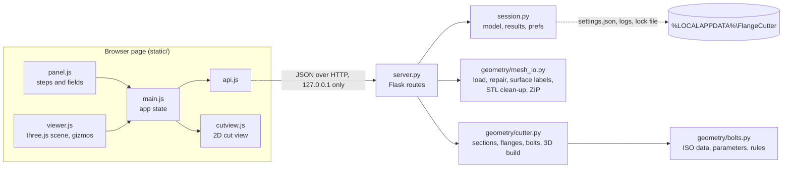

# Architecture

Flange Cutter is a local web app: a small Python server does the geometry, and one web page in
the user's own browser shows the model and the controls. Nothing leaves the computer.

## Data flow



1. **Open**: the page uploads the STL (`POST /api/model`). `mesh_io.load_stl` reads it with
   trimesh, repairs small problems, checks it is closed, builds a Manifold twin, and labels every
   face: outer side, inner side or rim of a thin shell, or OTHER (step 1 below).
2. **Edit cuts**: every change (plane, side, bolts, parameters of any cut) sends all cuts to
   `POST /api/preview` (debounced). The answer is 2D data per cut in that cut's plane frame;
   the page draws it on the planes and in the 2D cut view.
3. **Generate**: `POST /api/generate` builds the solid once, splits it into parts, checks them,
   and returns the parts list. The page loads each part's STL and places it with its matrix.
4. **Export**: the part STLs (cleaned of sliver triangles, step 13 below) and a ZIP (all parts +
   `report.txt` + `settings.json`) are plain downloads.

State lives in memory (`session.py`): one open model and the last three results. On disk the
app writes only to its folder in the user profile: `settings.json` (last-used values),
`logs/flangecutter.log` (rotating at 1 MB, with the 3 older files kept: 4 MB at most) and
`flangecutter.lock` (the port of the running
app). `FLANGECUTTER_HOME` overrides the folder (tests use it).

## Modules

| File | Job |
|---|---|
| `flangecutter/__main__.py` | Start: logging, single-instance check (lock file + `/api/ping`), server on 127.0.0.1 with a free port, open the browser. If another version is running, it offers in its console window to close that one (`/api/shutdown`) and then starts; without a console it opens the running one. |
| `flangecutter/server.py` | Flask routes. Thin: validation and geometry live in `geometry/`. Maps `CutError` to HTTP 400. Refuses requests whose Host or Origin is not local. |
| `flangecutter/session.py` | In-memory model and results; app folder; preferences. |
| `flangecutter/geometry/bolts.py` | All ISO data, the fastening registry, parameter metadata (labels, units, ranges, help), derived defaults, the bolt length rule. |
| `flangecutter/geometry/mesh_io.py` | Load, repair, check; label every face at load (outer side, inner side, rim or OTHER: `shell_surfaces`); STL output with sliver clean-up (`stl_bytes`); ZIP output. |
| `flangecutter/geometry/cutter.py` | Plane frames, sections, flange outlines, bolt placement, all checks, 3D build, parts, reports. |
| `flangecutter/static/` | The page: `index.html`, `app.css`, `js/main.js` (wiring and state), `js/viewer.js` (3D), `js/panel.js` (steps and fields), `js/cutview.js` (2D SVG), `js/api.js` (fetch helpers), `vendor/three/` (three.js r187, unmodified). |

## Coordinate conventions

- Units are millimeters everywhere.
- World coordinates are the STL's coordinates. The viewer is Z-up (`camera.up = (0, 0, 1)`), like
  the slicer.
- A cut plane is a three.js object: **origin** = its position, **normal** = its local +Z axis,
  **in-plane x axis** = its local +X axis. The page sends all three; the server builds an
  orthonormal frame from them (`cutter.plane_frame`), so the 2D view matches what the user sees.
- **Plane coordinates** of a cut: the plane is z = 0, the normal is +z, x and y are the in-plane
  axes. Every 2D result (section, flange, bolts) is in these coordinates, with the frame returned
  alongside.
- Side **A** of a cut is where its normal points (shown as an arrow; the page calls it the
  "arrow side"); side **B** is the other side.
- Parts are named A, B, C… in order of their **side signature** (the side of every cut, e.g.
  `"AB"`), the largest body first where one signature has several bodies. With one cut, part A is
  on side A; part B is on side B unless side A has several bodies.
- Print position: a part lies with one of its cut faces on the print sheet (z = 0). For side A
  that is the cut's plane coordinates; for side B the same turned 180° about the plane x axis.
  `to_world` (row-major 4 × 4) maps the print position back to the world for display.

## API

Requests and answers are JSON, except the STL upload (multipart) and the STL and ZIP downloads.
Errors are `{"error": "<plain-language message>", "detail": "<technical>"}` with HTTP 400 (the user
can fix it), 403 (a request from outside this computer), 413 (a file over 512 MB) or 500 (a bug;
details in the log).

| Route | Purpose |
|---|---|
| `GET /` | The page. |
| `GET /api/ping` | `{"app": "flangecutter", "version"}`: the single-instance check. |
| `GET /api/bolts` | Bolt sizes with ISO data and automatic values, fastening types, parameter metadata, count and spacing ranges, defaults, version. |
| `POST /api/model` | Multipart `file`. Returns `model_id`, `name`, `sha256`, `triangles`, `bbox` (`min`, `max`, `size`, `center`), `watertight`, `repaired`, `warnings`. |
| `GET /api/model/<id>/mesh.stl` | The checked mesh, for display. |
| `POST /api/preview` | 2D layout of every cut (below). HTTP 200 also when a cut has a problem: that cut carries `error`. An invalid request (a model that is no longer open, no cuts, unknown or out-of-range settings) gets HTTP 400. |
| `POST /api/generate` | 3D build. Returns `result_id`, `parts`, `cuts`, `hardware`, `warnings`, `preview`, `zip`, `seconds`. HTTP 400 if any cut has an error. |
| `GET /api/progress` | `{"busy", "stage", "fraction"}` while a job runs. |
| `GET /api/result/<id>/<part>.stl` | One part in print position, e.g. `A.stl`. |
| `GET /api/result/<id>/bundle.zip` | All parts + `report.txt` + `settings.json`. |
| `GET` / `POST /api/prefs` | Last-used settings (kept across upgrades). |
| `POST /api/shutdown` | Stop the server (the Quit button). |

**Request** for preview and generate:

```json
{"model_id": "abc123",
 "cuts": [{"plane": {"origin": [0, 0, 120], "normal": [0, 1, 0], "x_axis": [1, 0, 0]},
           "side": "outside", "bolt": "M4", "fastening": "through_nut", "nut_pocket_half": "B",
           "distribution": {"mode": "count", "count": 8, "spacing": 50},
           "params": {"thickness": null, "width": null, "hole_diameter": null, "wall_gap": 1.0,
                      "edge": 2.0, "hole_clearance": 0.2, "max_wall_angle": 25,
                      "tool_clearance": 12, "end_margin": 3}}]}
```

`null` means automatic. The spec's single-cut form (the cut's fields at the top level, with
`count`) is still accepted; unknown parameters such as the spec's `overlap` are ignored. The **settings file** (Save settings, and `settings.json` in the ZIP)
is `{"format": 1, "app", "version", "model": {"name", "sha256"}, "cuts": [...]}` with the same
cut objects, so loading it is just sending its cuts.

**Preview response**, per cut: `frame` (origin, x_axis, y_axis, normal), `error` (or null),
`section` and `flange` (polygons as `{"exterior": [[x, y], …], "holes": [[[x, y], …], …]}`),
`bolts` (`xy`, `xyz`, `blocked`), `bolt_line` and `free` (polylines: the whole bolt line and the
stretches where bolts may go), `crossings` (lines where other cuts cross this plane), `cavities`
(label points), `derived` (thickness, width, bolt_line, hole_diameter, washer, bolt_length, grip,
pocket size, how far the bolt line moved), `count`, `suggested_count`, `warnings`. Top level:
`warnings` that involve two cuts, `ms`.

**Generate response**: `parts[]` (`name`, `file`, `url`, `signature`, `volume_cm3`, `size`,
`triangles`, `face_down`, `cuts`, `bolts`, `overhang_cm2`, `to_world`, `explode`), `cuts[]` (bolt
spec, nuts, washers, flange values and `joins`: which parts the cut bolts together, with how many
bolts), `hardware` (shopping list for all cuts), `warnings` (each `{code, message, action}`), and
`preview` (the final 2D layout).

## Geometry, step by step

Per cut, in that cut's plane coordinates (`cutter.section` and `cutter.layout`):

1. **Load and repair** (`mesh_io.load_stl`): trimesh with `process=True`; drop degenerate and
   duplicate faces; fix winding (networkx); refuse if not watertight ("This model has holes…");
   turn the whole model the right way out when its volume is negative (one inside-out body among
   several stays as it is); build the Manifold, which must report `NoError`. Then **label every face**
   (`mesh_io.shell_surfaces`). A thin-walled mold is a thickened surface: an outer and an inner
   side, joined along the mold's edge by a narrow **rim** that meets them at sharp edges.
   - Faces are grouped into patches across smooth edges (under 45°). A patch is **thin** when its
     area divided by the length of its border is under the wall thickness estimate (the model's
     volume / half its area): a strip up to about twice the wall wide.
   - Thick patches joined across sharp edges make a **surface**. Thin patches joined across sharp
     edges make a **thin region**.
   - A surface faces **outward** when, weighted by area, its normals point away from the center of
     its body; otherwise it faces **inward**. The outward surfaces are the outer side of the wall,
     with any raised pad or label on it. The inward ones are the inner side (several where two
     cups are joined).
   - A thin region that touches surfaces of one side only (all outward or all inward) belongs to
     the largest of them (the walls of a pad, the walls and floor of an engraved line). One that
     touches both sides is **rim**, also when it is made of several facets.
   - A body with outward and inward surfaces joined by rim is a **thin shell**. Every other body is
     labeled **OTHER**, and the cutter uses the POC's per-segment rule there (step 3).
   - `Model.surfaces` holds every face's label (a surface id, `RIM` or `OTHER`); `Model.outside`
     holds the ids of the outward surfaces.
   - A thin-walled body (wall thickness under 0.1 × its smallest extent) that comes out OTHER gives
     the warning `edge_not_found`: "Flange Cutter could not find the edge of this mold (it may be
     rounded). It chooses the flange side piece by piece along each cut." Action: "Check the flange
     in the preview, especially near the edge of the mold."
2. **Section**: `Manifold.slice(0)` gives the wall section; `trimesh.intersections.mesh_plane`
   gives the same outline as segments, each with the mesh face behind it (its normal, how far the
   wall leans, and its label). Both are also taken at z = ±T/2 and ±T (T is the flange thickness
   of each part), where the flange layers end (step 4): a leaning wall moves the protected face
   there, and the mold's edge may lie elsewhere, or the wall may not reach that far.
3. **Flange side**: "Outside" gives the flange to every segment of the outward surfaces, "Inside"
   to every segment of the inward surfaces, along the whole cut. The other side of the wall is the
   **protected face**. Rim segments never get flange: they are guarded like the protected face.
   For OTHER faces the POC's rule applies (decision 13): per connected region of the section the
   reference point is the centroid of its convex hull, and a segment faces away from the cavity
   when its normal points away from that point ("Outside" uses those segments, "Inside" the
   others). The segments are merged into **flange chains** and **guard chains** (protected face
   and rim) with `linemerge` (coordinates rounded to 1e-5 mm). Each chain gets a sign (which side
   its face normals point to) and each piece of a flange chain its lean, both read from the mesh
   face behind it. At the other heights `Section.levels` keeps the wall section, the guard chains
   with their signs, and the flange chains.
4. **Flange outline (2D)** (`cutter._flange_outline`), with W the flange width:
   - **Bands**: per flange chain, a band of width W on the flange side and a fixed 0.6 mm strip
     into the wall (`OVERLAP`; the "Overlap into wall" setting is gone, and old settings files
     that contain it still load).
   - **Wedge fill**: where the wall leans away from the flange by more than 8° (`FILL_NZ`) on one
     half (z 0..T or −T..0), that half also gets a band of width W into the wall. Not within W of
     an open chain's end.
   - **Guard bands** at z = 0, ±T/2 and ±T: W + 2 mm beyond the protected face and the rim,
     clipped by the wall section at that height. Only the pieces that touch the protected face or
     the rim are kept: where the wall bends sharply, the band also reaches across the wall and
     would cut away good flange. Grown by 0.1 mm, so the flange stops 0.1 mm short of the
     protected face.
   - **Layers**: each half is two layers, 0..T/2 and T/2..T (side B: −T/2..0 and −T..−T/2). Each
     layer loses the guard bands at both of its faces. On a half with wedge fill the protected face
     moves away from the flange as the height grows, so the outer layer reaches further into the
     wall than the inner one.
   - **End cuts** (`_end_cuts`, `_uncovered`), per flange chain and per layer face (z = 0, ±T/2,
     ±T). (1) Along stretches of the chain with no wall within W + 2 mm at that height, the chain's
     bands are cut away: the mold's edge is lower there, so a layer at that height would stand past
     it. (2) At every end of a flange chain at that height that meets a guard chain (the rim; on
     OTHER models the face where the flange side flips), the guard chain is carried on past the end
     by 3W + 2 mm. Its guard band, 3W + 2 mm wide, is cut away from the bands of the chain at the
     cut nearest to that end. That far, because where the face meets the edge at a shallow angle the
     flange band crosses the edge line far from the end. Each cut trims its own chain's bands only.
     So the flange ends flush with the mold's edge at every height where a layer ends, also where
     the edge meets the cut or the face at a slant. Where the edge is closer to the cut than the
     flange half's thickness, the layers that reach past it get no flange there. The flange is then
     shorter or thinner, and the checks of steps 8 and 12 warn when washers no longer fit or a part
     is not bolted.
   - **Result**: the cut-face outline (the preview's `flange`) is the union of the two inner
     layers. When no chain gets a wedge fill and the other heights take nothing more, one outline
     serves the whole slab (`Layout.uniform`). Every outline is snapped to a 0.01 mm grid.
5. **Bolt line**: the chains offset by c toward the flange side, sampled every 0.5 mm; only the
   stretches where a bolt clears every other cut stay (see below).
6. **Bolts**: by arc length; evenly around closed rings; on open stretches with the end margin
   (c + washer/2 + end distance) at real flange ends. Count mode shares the count by length
   (largest remainder, at least 2 per stretch where they fit); spacing mode aims for the given
   distance. Too many bolts for the room is an error that names the maximum.
7. **Tool clearance**: the mold beyond both flange faces (up to the tool clearance) is projected
   onto the plane once; a bolt is blocked if its tool disc (washer/2 + 0.5 mm) overlaps that
   shadow. While any bolt is blocked the bolt line moves out 1 mm (up to 6 mm).
8. **Checks and warnings**: wall angle (95th percentile of the flange-side lean), bolt spacing,
   washer fit (on both outer faces of the flange, z = ±T), blocked bolts, count raised, stretches
   without room for a bolt.

**Crossing cuts.** A bolt position p of cut i is kept only if, for every other cut j,
`max(0, |dist(p, plane j)| − (T_i + max(H_i, protrusion_i))·|cos θ|) − r_i·sin θ ≥ T_j + protrusion_j + 0.5 mm`,
where θ is the angle between the planes, H the tool clearance, r = washer/2 + 0.5 mm and
protrusion = how far bolt end, nut or head stick out of a flange face. So holes, washers, nuts and
tools of one cut never meet the other cut's flange or hardware. Two cuts must cross inside the
wall at 15° or more, or keep their flanges apart; this is judged from where each plane lies
relative to the other cut's wall section.

Then, once for all cuts (`cutter.generate`):

9. **Solid**: mold ∪ every flange solid − every bolt hole and nut pocket. Only **then** split by
   every plane in turn. A flange solid (`cutter._flange_solid`) is one slab from −T to +T when one
   outline serves it. Otherwise it is a core over the cut-face outline from −T/2 to T/2, minus
   trimming prisms for the inner layers that start 0.02 mm off the plane, plus the outer layers
   (T/2..T and −T..−T/2) with their own outlines, sitting exactly on the core at ±T/2. No face of
   it lies on the plane where the parts are split.
10. **Parts**: each cell is split into its bodies; loose pieces of flange without mold are left
    out; every body is a part.
11. **Joins and orientation**: slices just beside every cut give each part's cut faces, which
    parts touch and which bolts hold them. Each part lies on the cut face that leaves the least
    overhang (ties: the larger face).
12. **Checks**: parts or joints with no bolt or one bolt, small or mostly-flange parts, flanges
    that print in mid-air, and an export-and-reload watertight check of every part.
13. **STL export** (`mesh_io.stl_bytes`, used by that check and by the downloads): booleans can
    leave sliver triangles without area, which slicers report as errors. Manifold's
    `simplify(1e-4 mm)` removes most of them (no surface moves more than 0.1 µm). Then a needle
    triangle that only flattens when rounded to float32 loses its shortest edge if that is under
    1e-4 mm (its two points merge). Every step is checked on the mesh as an STL reader sees it
    (float32 points, equal points merged): a step that would leave an open or non-manifold edge is
    skipped (the unsimplified solid is used, or the needle stays). So a part's STL file has
    slightly fewer triangles than its solid (`triangles` in the generate response counts the
    solid).

### Pitfalls (found the hard way; keep them)

- **Split last.** Adding a flange to an already split half makes coplanar faces; after float32
  STL export such parts are no longer watertight.
- **Never move the 3D split off the plane.** Vertices exactly on the plane are handled by
  Manifold. Only the trimesh outline is shifted by 1 µm (duplicate edges otherwise). Shifting the
  split leaves 1 µm slivers that break after export.
- **Snap flange outlines** to 0.01 mm. Outline points made from chain ends lie exactly on the
  mold surface; Manifold then leaves sub-micron edges that collapse in float32.
- **No GEOS single-sided buffers.** They misbehave on closed rings. On long wavy open chains of a
  real section they returned a band that starts its own width away from the chain (on the four
  real molds, GEOS disagreed with the swept band on 204 of 781 chains). `_side_band` uses polygon
  offsets for closed rings and `_swept_band` (one quad per piece, plus joints) for open chains.
- **Simplify the band geometry, never the chains.** `_side_band` simplifies a chain by 2 µm (far
  under the 0.01 mm grid) before banding, because a band costs time per piece. The chains keep
  every piece: signs and leans are read per piece from the mesh face behind it, and a long
  simplified piece along a thin wall finds the other face and flips the sign.
- **Classify by surface, not by segment.** On a wavy profile (a face mask cut through the nose)
  the POC's per-segment rule flips sides and breaks the flange into pieces on both faces. A
  surface's side comes from the way it faces, not from its size: a raised pad or label on the
  outer side faces outward too, and two joined cups have two inward surfaces.
- **Leaning walls need layers.** A straight slab next to a leaning wall pokes through the
  protected face unless every layer is trimmed by the guards at both of its faces. Where the wall
  leans away from the flange, a slab that only touches the wall leaves a wedge-shaped gap, and one
  straight strip cannot fill it without passing the protected face near the cut. Hence two layers
  per half, each cut back by its own guards.
- **End the flange at the mold's edge per chain and per layer face.** A guard band stops where its
  chain stops, at the flange chain's end. Where the face meets the edge at a slant, the flange band
  passes the edge line beside it; where the edge meets the cut at a slant, the edge moves with the
  height. Hence the end cuts of step 4. Measured on the synthetic test mask (its edge is the plane
  x = 10): 0.00 mm³ of flange past the edge for sagittal, 30° and 45° cuts, both sides (1.0.0:
  2,246 to 4,732 mm³ with Outside). Each end cut trims its own chain's bands only. Guard chains
  prolonged for all chains at once (1.0.0) crossed where a mold's edge opening was narrow, and the
  buffer of the self-intersecting line once erased a whole flange (decision 43).
- **Never let the flange touch a mold face exactly.** Trimmed exactly at a square wall or a flat
  rim, the flange shares faces with the mold, which breaks after export; the guard keeps 0.1 mm.
- **Stack the flange layers exactly.** Outer layers that overlapped the core by 0.02 mm, or were
  one grid step smaller, left slivers that were not watertight after float32 STL export. They sit
  exactly on the core at ±T/2; only the trimming prisms start 0.02 mm off the plane (step 9).
- **`stl_bytes` changes the mesh.** Its clean-up also merges the triangles of flat areas (a test
  cone went from 23,552 to 1,024 triangles). Tests that need a mesh's own triangles write it with
  `mesh_io.to_trimesh(m).export(file_type="stl")`.
- **Bands and guards are built in threads** (`_parallel`, up to 8): shapely (GEOS) releases the
  GIL, which made previews 1.5 to 1.9× faster on the real molds. Each job only reads the section
  and returns new geometry.
- **Thin-shell test probes** (`shell_checks` in `tests/test_geometry.py`) sit just off the mold
  faces. A probe is kept only where the probe itself lies within T − 0.3 mm of the cut: on a
  leaning wall the step along the face normal also moves it off the plane, out of the flange.
  `dirty` (flange on the protected face) and `past_rim` count only what Generate added (parts minus
  the mold): on creased real mold faces a step along the normal can land back inside the mold. The
  `dirty` and `covered` checks fail when they have no probes, instead of passing. A volume check
  past a planar mold edge found an overhang the probes missed
  (`test_flange_is_flush_with_a_slanted_mold_edge`).
- **trimesh 5** `fix_normals()` silently needs scipy; call the repair steps one by one.
- **trimesh caches** re-hash the whole mesh on every access to `face_normals` and `bounds`; the
  model keeps plain copies.
- **Manifold is lazy**: an operation's cost shows up where its result is first used.
- **Manifold.to_mesh() is float32**: take heights from `bounding_box()` (double).
- **Windows MIME types**: some registries serve `.js` as `text/plain`, which breaks ES modules;
  `server.py` registers the right type.

### Known limits

- **Very steep walls** (the wall almost parallel to the cut, for example 74° median from square
  on one real cut): two layers per half cannot reach all of the flange face (about 75 %
  covered on that cut). The wall-angle warning appears there: "Cut n: the wall meets the cut at up
  to …° from square." Action: "The flange may not sit flat. Rotate the cut so it crosses the wall
  more squarely."
- **The mold's edge is checked at five heights only** (z = 0, ±T/2 and ±T, where the layers end).
  An edge that bulges toward the cut between them can leave a small overhang.
- **Rounded edge**: no rim is found, so the body is OTHER. The warning `edge_not_found` appears
  (step 1), and the flange side is chosen piece by piece.
- **No wedge fill within W of the mold's edge**: there, only the 0.6 mm strip reaches into the
  wall.
- **A cut closer to the mold's edge than the flange half's thickness** gets a shorter or thinner
  flange there (step 4).

## Performance

Version 1.0.1, measured on the development laptop on 2026-11-07 (server side, Python 3.12,
lengthwise cut through the middle of the demo mold shape at different resolutions; median of 3 runs
where marked, the faster of two such runs). In brackets: version 1.0.0, measured back to back on the
same laptop. The laptop's speed drifted by up to 2 times within minutes (the 1,000,000-triangle rows
ran at its slower speed, 1.0.0 included), so compare within a row.

| Model | Open and check | Preview (cut moved / only bolts changed) | Generate |
|---|---|---|---|
| Demo mold, 32,000 triangles, one cut (median) | 0.13 s (0.11) | 0.12 s / 0.005 s (0.06 / 0.02) | 0.25 s (0.22) |
| 102,000 triangles, one cut (median; spec target 0.3 s / 3 s) | 0.56 s (0.46) | 0.20 s / 0.01 s (0.11 / 0.03) | 0.66 s (0.63) |
| 954,000 triangles, one cut | 11.8 s (10.2) | 1.70 s / 0.05 s (1.20 / 0.10) | 13.0 s (10.5) |
| 954,000 triangles, two crossing cuts | | 1.5 s / 0.14 s (1.6 / 0.34) | 7.1 s (7.0) |

A moved cut previews about 1.4 to 2 times as long as in 1.0.0: each cut is sectioned at five
heights instead of three, and every chain gets its end cuts (step 4). A change of the bolts alone is
faster than in 1.0.0, because the flange outline is kept per section, T and W
(`Section.outlines`). Opening also labels the surfaces (about 0.1 s at 100,000 triangles). The
tilted transverse cut of the speed test (`tests/test_geometry.py`, 102,000 triangles), where the
bolt line moves out twice, takes about 0.16 s to preview and 0.8 s to generate. On the four real
face-mask molds (120,000 to 241,000 triangles) the preview took 0.39 s (median) and at most 0.87 s,
on a busy laptop (validation run 8).

Each cut's section is cached on the model, so moving one cut recomputes only that cut's section;
the other cuts are laid out again from their cached sections. The page shows a progress bar during
Generate (`/api/progress`).

## Extending

- **Bolt size**: one `Bolt(...)` line in `geometry/bolts.py` (hole, washer, nut data). The page
  reads sizes from `/api/bolts`.
- **Fastening type**: add a `Fastening` to `FASTENINGS` (label, help, washers per bolt), give it
  a grip rule in `bolts.bolt_length()`, and, if it changes the solid, its cutters in
  `cutter._fastening_cutters()`. The page reads the list from `/api/bolts`.
- **Parameter**: add a `Param` to `PARAMS` (label, unit, range, default, help); the page builds
  the field from the metadata; use the value in `bolts.derive()`.
