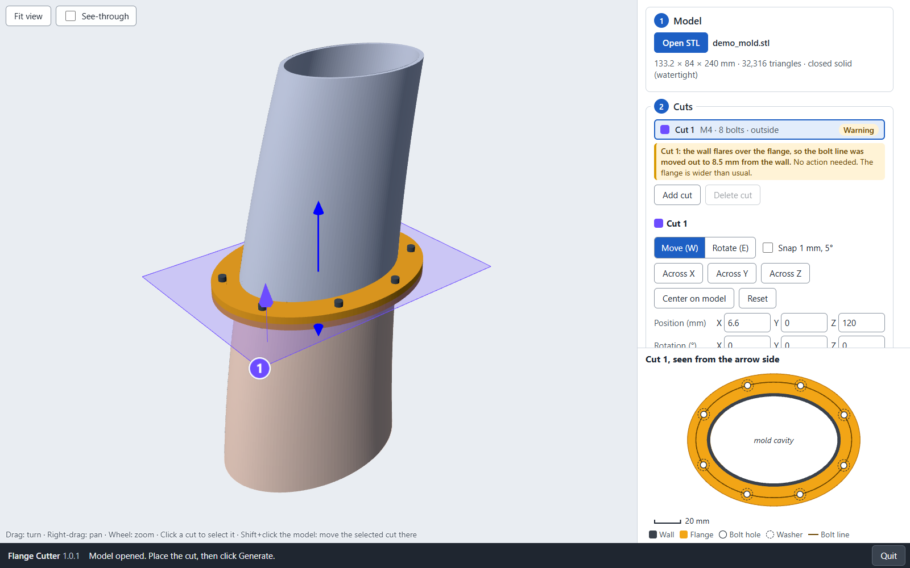
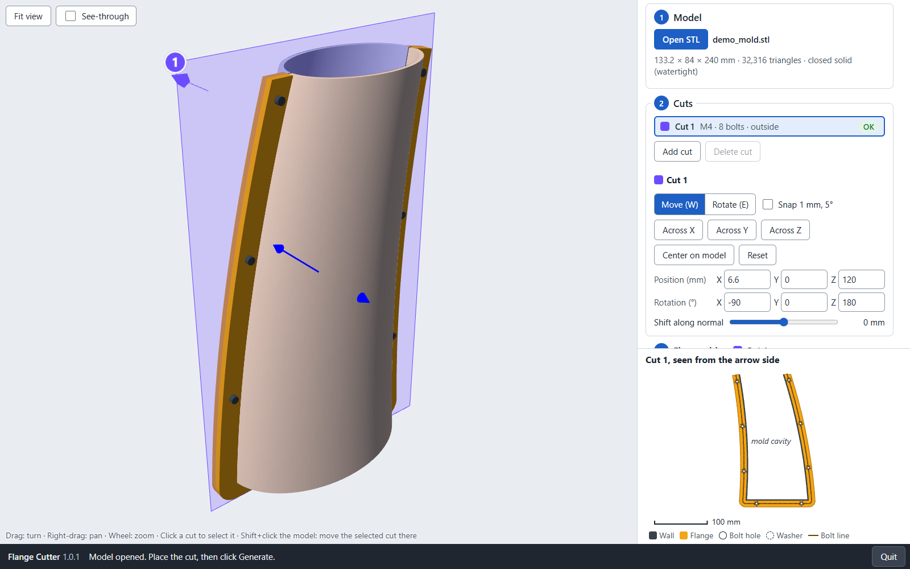
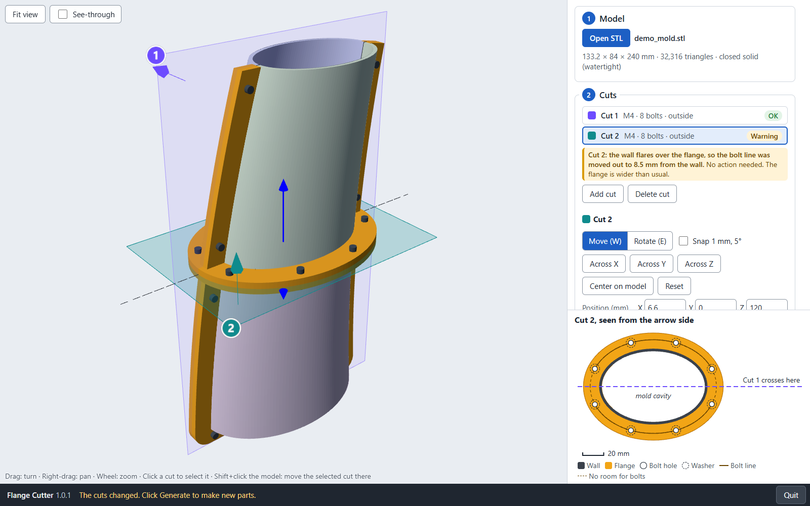
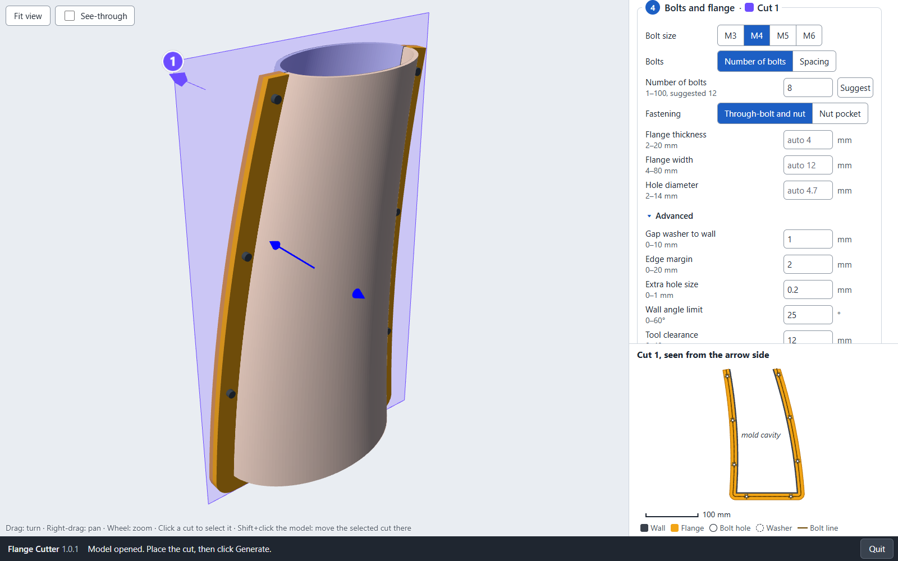
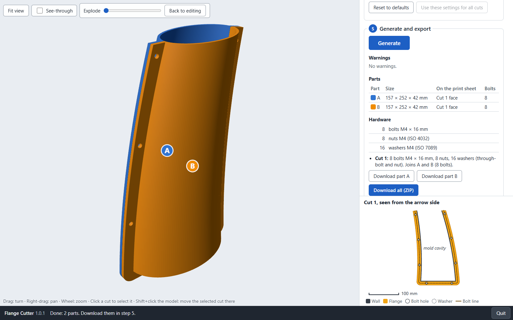
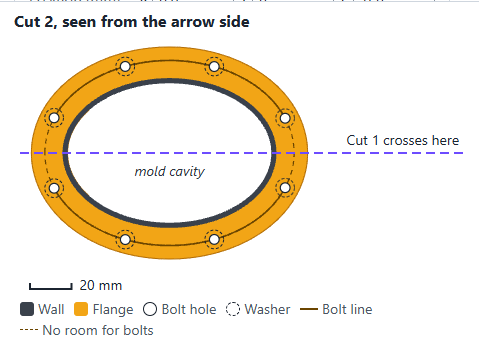

# Flange Cutter user manual

Version 1.0.1

## What Flange Cutter does

Some molds are too big for your printer, or must open to take the cast out. Then the mold must be
cut into parts. A mold wall is only 2 to 3 mm thick, so pins or dovetails do not fit in it.

Flange Cutter cuts the mold and adds a **flange** along every cut: a flat rim that grows from one
face of the wall, normally the outside. Bolts go through the flanges of the two parts and hold them
together. The other face of the wall, the mold surface, stays clean.

You can make one cut, or several cuts at any angle. You get one STL file per part, ready to print,
and a list of the bolts, nuts and washers you need.

Flange Cutter works offline. Your files stay on your computer.

## Unzip, start, update and remove

Flange Cutter comes as one ZIP file. Nothing is installed, and you do not need admin rights.

**Unzip**

1. Right-click `FlangeCutter-1.0.1-portable.zip` and choose **Extract All**. Pick a folder where
   you can save files, for example **Documents**.
2. Open the new **FlangeCutter** folder and double-click **FlangeCutter.exe**.
3. If Windows shows "Windows protected your PC", see the next section.

Do not start FlangeCutter.exe from inside the ZIP without extracting it: it does not work there.
For a desktop shortcut, right-click **FlangeCutter.exe** and choose **Show more options > Send to >
Desktop (create shortcut)** (Windows 10: **Send to** is in the first menu).

**Start and quit.** Double-click **FlangeCutter.exe** (or your shortcut). A small black window
opens ("Close this window to quit") and your web browser shows the app. Starting it again while it
runs only opens the browser on it. To quit, click **Quit** at the bottom right, or close the black
window.

**Update.** Quit Flange Cutter. Delete the old **FlangeCutter** folder and extract the new ZIP in
its place. Your settings stay. If an older version still runs when you start the new one, the black
window asks you to press Enter to close the older version first.

**Remove.** Delete the **FlangeCutter** folder. Your settings and the log stay in
`%LOCALAPPDATA%\FlangeCutter`; delete that folder to remove them too.

**Version 1.0.0 was installed with Setup?** Remove it once: open **Settings > Apps > Installed apps**
(Windows 10: **Apps & features**), find **Flange Cutter** and choose **Uninstall**. Your settings
stay. Then use the ZIP as above.

## If Windows protects your PC

Windows may show **"Windows protected your PC"** for a new program it does not know yet.

1. Click **More info**.
2. Click **Run anyway**.

This does not need admin rights. If your laptop is managed by your organization and still blocks
Flange Cutter, ask your IT team.

## The five steps

The panel on the right has five steps. Steps 2 to 5 open as soon as a model is open. The 3D view
on the left shows the model and the cuts. Drag to turn the view, right-drag to move it, use the
mouse wheel to zoom. **Fit view** shows the whole model again.

### Step 1: Model

Click **Open STL**, or drag an STL file onto the 3D view.

Flange Cutter checks the file and shows its size in mm, the number of triangles and the check
result. It fixes small errors by itself. If the model has holes, repair it first, for example with
your slicer's repair function, and open it again.

If the model is smaller than 10 mm or larger than 2,000 mm, it is probably in the wrong unit. Scale
it to millimeters in your slicer and open it again.

### Step 2: Cuts

Flange Cutter places a first cut across the longest side of the model. Each cut is a transparent
plane with a number and an **arrow**. The side the arrow points to is the **arrow side**.

The model is colored by the parts the cuts will make.

To place the selected cut:

- **Move (W)** shows one arrow: drag it to move the cut. **Rotate (E)** shows two rings: drag them
  to tilt the cut. The keys W and E switch between the two.
- **Across X**, **Across Y**, **Across Z** put the cut straight across the model, through its
  center. **Center on model** moves the cut to the center. **Reset** puts it back where it started.
- Type exact numbers in **Position (mm)** and **Rotation (°)**.
- **Shift along normal** slides the cut along its arrow.
- **Snap 1 mm, 5°** makes the cut move in 1 mm steps and turn in 5° steps.
- **Shift+click** on the model moves the cut to that point.

**Several cuts.** Click **Add cut** for another cut (up to 6). It starts with the same settings as
the selected cut, turned or moved so it does not lie on another cut. **Delete cut** removes the
selected cut.

**Select a cut.** Click it in the list, or click its number in the 3D view. You can also click its
plane, away from the handles of the selected cut (the arrow or rings you drag). Next to those
handles, and where the selected cut's plane crosses another plane, a click does not change the
selected cut, so a slightly missed handle never switches cuts. The list always works.

Every cut has its own settings in steps 3 and 4. The step titles name the cut they change.

The list shows each cut's state: **OK**, **Warning** or **Error**. Read the message under the list.
Cuts may cross. Where two cuts cross, the app keeps bolts away from the crossing, so the bolts of
the two cuts never meet.

### Step 3: Flange side

- **Outside** (normal choice): the flange grows from the outer face of the wall.
- **Inside**: the flange grows from the inner face.

The mold face on the other side stays clean. Choose the side that is **not** the mold surface. For
example, when plastic is formed over the outside of the mold (like a face mask mold), choose
**Inside**. The flange follows that face along the whole cut and stops flush and square at the
mold's edge. Marks on the wall, such as a raised pad, a label or an engraved line, are fine: they
count as part of the face they are on.

If the mold's edge is rounded, Flange Cutter may not find it. Then step 1 shows the warning "Flange
Cutter could not find the edge of this mold", and the flange side is chosen piece by piece along
each cut. Check the flange in the preview, especially near the edge of the mold: it should stay on
the face you chose.

### Step 4: Bolts and flange

- **Bolt size**: M3, M4, M5 or M6.
- **Bolts**: choose **Number of bolts** (click **Suggest** for about one bolt every 50 mm), or
  **Spacing**, the distance between bolts in mm.
- **Fastening**:
  - **Through-bolt and nut**: a washer under the bolt head, and a washer and a nut on the other
    side. You need a tool on both sides.
  - **Nut pocket**: a hexagonal pocket in one flange holds the nut, so you need only one tool.
    Choose which part gets the pockets: **Arrow side** or **Other side**.
- **Flange thickness**, **Flange width** and **Hole diameter**: leave them empty for the automatic
  value, which is shown in gray.
- **Advanced** holds the other values. Leave them as they are unless you have a reason.
- **Reset to defaults** sets this cut back to the normal values. **Use these settings for all cuts**
  copies this cut's side, bolts and flange to the other cuts.

Every field shows its unit and allowed range. Point at a field to read what it does. A field
with a wrong value turns red.

### Step 5: Generate and export

Click **Generate**. A bar shows the progress. Large models take longer.

Then the 3D view shows the parts, each with a letter: A, B, C… Use the **Explode** slider to move
them apart. **Back to editing** shows the cuts again.

The panel shows:

- **Warnings**: what to check, and what to do.
- **Parts**: size, the face that goes on the print sheet, and the number of bolts.
- **Hardware**: all bolts (with their length), nuts and washers to buy. Under it, each cut lists
  its hardware and which parts it joins.
- **Download part A**, **Download part B**… one STL file each, and **Download all (ZIP)**: all
  parts, a `report.txt` with all the details and a `settings.json`.

The files go to your browser's **Downloads** folder. The file names carry the part letter, for
example `demo_mold_part_A.stl`.

**Save settings** saves all cuts to a file, so you can make the same cuts again later. **Load
settings** opens such a file. If it was saved for another model, the app warns you.

If you change anything after Generate, click Generate again to make new parts.

## Reading the 2D cut view

Under the panel, the 2D cut view shows the selected cut, seen from the arrow side.

| You see | It means |
|---|---|
| Dark gray band | The mold wall, where the cut goes through it. |
| Amber area | The flange. |
| White circles | Bolt holes. |
| Dashed circles | The washers. They must lie on the flange. |
| Line through the holes | The bolt line. A dashed part has no room for bolts (another cut is too close). |
| Red bolt | A tool cannot reach this bolt: the wall is in the way. |
| Colored dashed line, "Cut 1 crosses here" | Another cut crosses this one. No bolts near it. |
| "mold cavity" | The inside of the mold. With **Outside**, the flange never grows into it. With **Inside**, the flange grows from the inner face into the cavity. |

## Warnings and errors

Each warning says what to do. The most common ones:

| Message (short) | What it means | What to do |
|---|---|---|
| The model has holes | The STL is not a closed solid. | Repair it in your slicer, export it again, open it again. |
| The model is only … mm / … mm across | Probably the wrong unit. | Scale it to millimeters, then open it again. |
| The model had small errors… fixed | Flange Cutter repaired it. | Nothing. Check the parts in your slicer. |
| Flange Cutter could not find the edge of this mold | The edge may be rounded. Flange Cutter chooses the flange side piece by piece along each cut. | Check the flange in the preview, especially near the edge of the mold. |
| Cut N does not go through the model | The cut misses the model. | Drag the cut onto the model, or delete it. |
| Too many bolts. At most … fit | The bolts would be too close together. | Lower the number of bolts, or click Suggest. |
| Some bolts are only … mm apart | Bolts very close together. | Lower the number of bolts or use a smaller bolt. |
| The wall meets the cut at up to …° | The cut crosses the wall at a slant. Where the wall is almost parallel to the cut, the flange may not cover the whole wall face. | Turn the cut so it crosses the wall more squarely. |
| The wall flares over the flange, bolt line moved out | The wall leans over the bolts. | Nothing. The flange is wider than usual. |
| The wall blocks the tool space at bolt … | A tool may not reach these bolts. | Move or turn the cut, or check you can reach them. |
| The washer does not fit on the flange | The flange is too narrow there. | Make the flange wider, or move the cut. |
| The washer does not fit… / Part X is not held by any bolt, on a cut near the mold's edge | The mold's edge is closer to the cut than the flange thickness. The flange there gets shorter or thinner, so that it ends at the edge. | Move the cut away from the edge of the mold. |
| No room for bolts … because cut N is too close | Two cuts are too close together. | Move the cuts apart. |
| Cut N is too close to cut M / crosses at only …° | Their flanges would merge. | Move them apart, or make them cross at 30° or more. |
| Each separate stretch of the cut needs 2 bolts | You asked for fewer bolts than the cut needs. | Nothing. |
| The flange was made … mm thick so the nut pocket fits | The nut needs room. | Nothing, or choose a smaller bolt. |
| No standard bolt up to 50 mm is long enough | The flange is very thick. | Make the flange thinner, or buy longer bolts. |
| Parts X and Y … no bolt / only 1 bolt holds them | A joint is weak. | Move the cuts so the joint is longer, or add bolts. |
| Part X is not held by any bolt | This part would be loose. | Move the cuts. |
| Part X is very small / mostly flange | A cut is close to the end of the model. | Move the cut away from the end. |
| A loose piece of flange was left out | One cut cut off a piece of another cut's flange. | Move the cuts so they cross inside the wall. |
| Part X: the flange of cut N hangs in the air | That flange has nothing under it when printed. | Turn on supports for this part in PrusaSlicer. |
| Part X may need a repair in your slicer | Rare problem in the exported file. | Let PrusaSlicer repair it, or move the cut 0.1 mm and generate again. |

## Printing the parts

- Each STL is already in **print position**: the cut face lies on the print sheet, so the flange
  lies flat. Do not rotate the part in the slicer.
- The flange needs **no supports**, unless the app warns that a flange "hangs in the air". That can
  happen when a part has two cuts facing each other, for example the middle piece of three. Turn on
  supports for that part only.
- Print each part from its own file. The **Parts** table and `report.txt` say which cut face goes on
  the print sheet.
- Write the part letter on each part with a marker when it comes off the printer.

## Assembly

1. Get the hardware from the **Hardware** list or `report.txt`. Each cut may need a different bolt
   length.
2. Put the parts together as in the 3D view (the Explode slider shows how).
3. **Through-bolt and nut**: put a washer under the bolt head **and** a washer under the nut.
   **Nut pocket**: press the nut into the hexagonal pocket; put a washer under the bolt head.
4. Put in all bolts and turn them only finger-tight. Check that the parts line up.
5. Tighten in a **cross pattern**: one bolt, then the bolt on the opposite side, and so on. Where
   cuts cross, tighten the bolts next to the crossing first.
6. **Do not overtighten.** The flanges are plastic: stop when the parts sit firmly together. If a
   flange bends or creaks, loosen the bolt a little.

## Questions and problems

**The browser did not open.** Open your browser and type the address shown in the black window,
for example `http://127.0.0.1:54736/`.

**The status bar says "Flange Cutter does not answer".** The black window was closed. Start
Flange Cutter again: it opens in a new browser tab. Work in the old tab is lost unless you saved
the settings, so click **Save settings** before you quit.

**Where are my files?** In your browser's Downloads folder.

**Can I cut a part again later?** Better make all cuts in one go (Add cut), so the flanges and
bolts of crossing cuts fit together. A part cut again later does not know the other parts.

**It is slow.** Large models (a million triangles) take several seconds. Wait for the progress bar.

**Something went wrong.** Note what you did, then send the log file to your support person:
`%LOCALAPPDATA%\FlangeCutter\logs\flangecutter.log` (paste this path in the File Explorer address bar).
